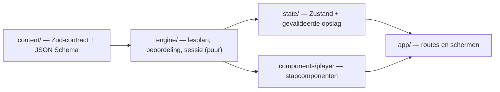

# pennig — van letter tot alinea

Leerapp voor Nederlands schrijven met Pim het potlood, opnieuw gebouwd in Next.js. Voor volwassenen die
Nederlands op moedertaalniveau lezen en verstaan, en de schrijftaal willen beheersen: van letter tot alinea.

Deze versie is **de interface en de oefenengine**. De lessen worden later apart uit PDF's gemaakt; de bestaande
lesinhoud draait ongewijzigd mee als referentie en testmateriaal. Voor "De letter", "Klank en letter", "De lettergreep",
"Het betekenisvolle woorddeel", "Het woord" en "De woordgroep" staan er al nieuwe lessen bij: praktische spellinglessen in de eerste drie niveaus, daarna tot masterniveau (zie [Eén inhoudsbron](#één-inhoudsbron)).

```bash
npm install
npm run dev          # http://localhost:3000
```

| Script                  | Wat het doet                                                              |
| ----------------------- | ------------------------------------------------------------------------- |
| `npm run dev`           | Ontwikkelserver                                                           |
| `npm run build`         | Productiebuild (alle lessen en voorbeelden statisch)                      |
| `npm run check`         | Typecheck, lint en unit-/componenttests                                   |
| `npm run test:e2e`      | Playwright op een productiebuild (desktop en mobiel)                      |
| `npm run content:check` | Valideert de lesinhoud tegen het contract                                 |
| `npm run content:schema`| Werkt het JSON Schema voor lesauteurs bij                                 |

Eerste keer e2e: `npx playwright install chromium`. Een draaiende server hergebruiken kan met
`E2E_BASE_URL=http://localhost:3000 npm run test:e2e`.

## Schermen

| Route                     | Scherm                                                                     |
| ------------------------- | -------------------------------------------------------------------------- |
| `/welkom/[stap]`          | Kennismaking (focus, tempo, startpunt); keuzes direct bewaard, terug werkt |
| `/`                       | Leren: Pim en de letterblokken van *boek* in 3D, "Verder met jouw les", de niveaus als 3D-toren met het groeiende voorbeeld, recente voortgang |
| `/lessen`                 | Bibliotheek: zoeken en filteren op niveau, vakgebied, status en oefenvorm (in de URL) |
| `/les/[lessonId]`         | Lesplayer; direct te openen, hervat na verversen                           |
| `/herhalen`, `/herhalen/sessie` | Opgeslagen oefenpunten en een herhaalronde (max. 8)                 |
| `/voortgang`              | Per niveau en vakgebied, oefentijd, laatst geoefend                        |
| `/instellingen`           | Geluid, rustige beweging, confetti, leerprofiel, export/import/wissen      |
| `/oefenvormen`            | Galerij van de nieuwe oefenvormen met voorbeeldinhoud (telt niet mee)      |
| `/woorden`                | Woorden: de ronde van vandaag, je reeks, alle woorden per thema, de methodes |
| `/woorden/vandaag`        | De woordenronde in de lesplayer; hervat na verversen                       |
| `/argumentatie`           | Begeleid leerpad voor leiders: logica, drogredenen, kaarten, oefenlab en video’s |
| `/argumentatie/les/[lessonId]` | Uitgebreide argumentatieles, reconstructie, casusreflectie en checkpoint |

Laden, lege toestanden, ontbrekende lessen (404) en fouten hebben elk een eigen scherm.

## Versies

Gecontroleerd op onderlinge compatibiliteit (peer dependencies). TypeScript 6/7 en ESLint 10 zijn bewust nog niet
gebruikt: `typescript-eslint` en de React-/a11y-plugins van `eslint-config-next` ondersteunen die nog niet.

| Pakket | Versie | Functie |
| --- | --- | --- |
| next | 16.3.8 | App Router, statische lesroutes, `typedRoutes` |
| react, react-dom | 19.3.0 | UI |
| typescript | 5.9.3 | `strict` + `noUncheckedIndexedAccess` |
| @base-ui/react | 1.8.0 | Dialog/AlertDialog, Tabs, RadioGroup, ToggleGroup, Select, Switch, Slider, Progress, Collapsible, Field/Input, NavigationMenu, Toast, Tooltip |
| tailwindcss, @tailwindcss/postcss | 4.3.3 | Ontwerptokens in `src/app/globals.css` |
| motion | 14.0.0 | Stapovergangen, kaartjes naar hun plek, herschikken, voortgang, Pim |
| @dnd-kit/core | 6.3.1 | Slepen van oefenblokken (altijd met klik-/toetsenbordalternatief) |
| konva / react-konva | 10.7.1 / 19.3.0 | Interactieve 2D-argumentatie-, causaliteits- en Bayes-labs, met een volledig tekstalternatief |
| zustand | 5.0.15 | Instellingen, voortgang, sessieherstel (localStorage) |
| zod | 4.6.5 | Lescontract en validatie van opgeslagen gegevens |
| lucide-react | 1.52.0 | Iconen (naast eigen SVG voor Pim, niveaus en vakgebieden) |
| canvas-confetti | 1.9.4 | Kleine beloning, pas geladen bij gebruik |
| three, @types/three | 0.183.2, 0.183.1 | De 3D-voorwerpen (WebGL), pas geladen als er een 3D-onderdeel op de pagina staat |
| vitest / jsdom | 5.0.3 / 30.1.2 | Unit- en componenttests |
| @testing-library/react, user-event, jest-dom | 16.3.3, 14.6.7, 7.0.1 | Componenttests van oefenvormen |
| @playwright/test | 1.63.0 | End-to-end (onboarding, les, hervatten, toetsenbord, rustige beweging) |
| eslint, eslint-config-next | 9.39.5, 16.3.8 | Lint incl. React Compiler- en jsx-a11y-regels |

Geluid gebruikt Web Audio (geen bestanden); fonts komen via `next/font` (Fraunces, Bricolage Grotesque, Figtree).
Voorlezen gebruikt de Nederlandse stemmen van de browser (Web Speech API, `nl-NL`). Bij klanken verdwijnt de
knop zonder spraakondersteuning; de leespagina’s vermelden wanneer Nederlands voorlezen niet beschikbaar is.

## Architectuur

Inhoud, beoordeling, voortgang en presentatie zijn gescheiden:



- `src/content` — het **inhoudscontract** (`schema.ts`, `kinds.ts`): cursus → niveaus → lessen → stappen, met
  semantische controles (antwoord tussen de opties, indexen binnen de zin, oplosbare puzzels, …). Presentatie staat
  er alleen in als semantische accentnamen.
- `src/engine` — puur en serialiseerbaar: lesplan met stabiele stapsleutels, beoordeling per oefenvorm, en de
  sessie als toestandsmachine (`answering → feedback → done`; fout = later in de les nog eens).
- `src/state` — Zustand-stores. Opslag wordt bij laden met Zod gevalideerd; beschadigde gegevens krijgen een
  reservekopie en een melding. Sessies die niet meer bij de inhoud passen, vervallen netjes.
- `src/components/player` — de lesplayer en één component per oefenvorm (`step-view.tsx` is het register).
- `src/app` — routes; `(app)` met navigatie, `(focus)` zonder (kennismaking, lessen, herhaalronde, woordenronde, voorbeelden).
- `src/content/words`, `src/lib/words`, `src/engine/fsrs.ts` — de tab Woorden (zie [Woorden](#woorden)).

### Eén inhoudsbron

De schrijflesbibliotheek gebruikt **alleen** `src/content/catalog.ts`. Die laadt de 29 lessen uit `legacy/build.ts` (byte-gelijk aan
de bron) via `adapters/legacy.ts`, voegt de nieuwe lessen uit `packs/` toe en valideert alles met het contract.
`legacy/course.ts` bevat alleen de typen: de tweede cursus (`COURSE`) en `BOOKS` zijn bewust weggelaten, zodat er
geen tegenstrijdige inhoud naast elkaar bestaat.

`packs/` bevat 84 nieuwe lessen voor zes niveaus, achter de bestaande lessen van dat niveau (`withExtraLessons`):

| Bestand | Niveau | Lessen |
| --- | --- | --- |
| `packs/praktijk/l20–l27.ts` | De letter | 8 — regels: het alfabet en spellen, hoofdletters (zin en namen; talen, dagen en feesten), accenten, het trema, de apostrof, het koppelteken · toets: alles door elkaar |
| `packs/praktijk/k30–k40.ts` | Klank en letter | 11 — regels: korte en lange klanken, ei of ij, au of ou, ng/nk en aai/ooi/oei/eeuw/ieuw/uw, g/ch/cht, langer maken (d/t, b/p), s/z en f/v, de doffe e, leenwoorden, ’t kofschip · toets |
| `packs/praktijk/g20–g28.ts` | De lettergreep | 9 — regels: lettergrepen vinden, open of gesloten, verdubbelen, meervoud, verkleinwoorden, de stam van een werkwoord, het bijvoeglijk naamwoord met -e, afbreken · toets |
| `packs/deel.ts` | Het betekenisvolle woorddeel | 8 — bachelor: morfeem en allomorf, buiging tegenover afleiding, de rechterhoofdregel, woordbomen, samenstellingen, tussenklanken, eisen van affixen en blokkering, stamwisseling en suppletie |
| `packs/deel-master.ts` | Het betekenisvolle woorddeel | 6 — master: morfeem, proces of paradigma, inheemse en geleerde lagen met de haakjesparadox, productiviteit meten, prosodische morfologie, het mentale lexicon en de d/t-fout, woordvorming in beweging |
| `packs/deel-extra.ts` | Het betekenisvolle woorddeel | 1 — bachelor: afkappingen, letterwoorden en mengwoorden (woordvorming zonder morfemen) |
| `packs/nieuw/d21–d24.ts` | Het betekenisvolle woorddeel | 4 — bachelor: werkwoorden met be-, ver- en ont-, persoonsnamen (bakker, bakster, schilderes), aaneen, met streepje of los · master: waar morfologie en zinsbouw elkaar raken (synthetische samenstellingen, argumentvererving) |
| `packs/woord.ts` | Het woord | 8 — bachelor: lexeem, woordvorm en lemma, woordsoorten bewijzen, conversie en de naamwoordelijke infinitief, sterke en zwakke werkwoorden, geslacht en verwijzing, de buiging van het bijvoeglijk naamwoord, betekenisrelaties, polysemie en homonymie |
| `packs/woord-master.ts` | Het woord | 6 — master: valentie en thematische rollen, onaccusativiteit (hebben of zijn), prototypen tegenover kenmerken, collocaties, idioom en frames, de wet van Zipf en lexicale dichtheid, partikelwerkwoorden en klitieken |
| `packs/woord-extra.ts` | Het woord | 2 — bachelor: leenwoorden, uitvoer en volksetymologie · master: het mentale lexicon (frequentie, priming, puntje van de tong, het model van Levelt) |
| `packs/nieuw/w23–w26.ts` | Het woord | 4 — bachelor: werkwoordspelling bewezen (word, wordt, gebeurd), die, dat, wat en wie · master: de vier gezichten van er, tijd en aspect |
| `packs/onderzoek/` | Woorddeel en woord | Een derde uitlegronde (`onderzoek`) met zwaardere oefeningen achter elke les van beide niveaus; `withResearch` plakt die achter de bestaande stappen |
| `packs/groep.ts` | De woordgroep | 4 — bachelor: bewijs voor de woordgroep (constituenttests), kern en bepalingen, de naamwoordgroep van binnen, bijvoeglijke naamwoorden stapelen (volgorde en komma) |
| `packs/groep-bouw.ts` | De woordgroep | 4 — bachelor: de voorzetselgroep en R-woorden, complement of bepaling, de bijvoeglijke groep, lange bepalingen voor en na (naamwoordstijl, bijstelling, beperkende en uitbreidende bijzin) |
| `packs/groep-master.ts` | De woordgroep | 4 — bachelor: nevenschikking en samentrekking · master: X-bar-theorie, structurele ambiguïteit en tuinpadzinnen, de DP-hypothese |
| `packs/groep-theorie.ts` | De woordgroep | 4 — master: kwantoren en bereik, de betekenis van bijvoeglijke naamwoorden, woordgroep of samenstelling, zwaarte, volgorde en typologie |

De eerste drie niveaus zijn praktisch: de spellingregels kennen en toepassen, zonder taalwetenschap, geschiedenis of
vergelijking met andere talen (`packs/praktijk/praktijk.test.ts` bewaakt lengte, afwisseling en interactiviteit).
Ze moeten ook uitdagen: geen beginletters als hint, geen opdrachten met twee keuzes, en elke les eindigt met lang werk
in vier oefenvormen uit `kinds-spelling.ts` en `kinds.ts`:

- **Reeks** (`drill`): twintig of meer woorden achter elkaar, zelf getypt; wat fout gaat, komt achteraan terug
  (hoogstens twee keer). Een opdracht kan een woord laten voorlezen (`say`).
- **Invultekst** (`cloze`): een hele tekst met gaten in de vorm `{antwoord|aanwijzing|uitleg}` (zie `content/cloze.ts`).
- **Tekstdictee** (`passage`): zin voor zin luisteren en typen, per woord nagekeken; zonder stem staat een zin een
  paar seconden in beeld en typ je hem uit je hoofd.
- **Nakijken zonder hulp** (`proofread` met `blind: true`): het aantal fouten blijft geheim, je typt elke verbetering
  zelf, woorden die fout lijken maar goed zijn (`trap`) kosten een misser, en je zegt zelf wanneer je klaar bent.

Een les kan een `stage` hebben (`regels`, `toets`, `bachelor` of `master`). Die verschijnt als label op de les en als
uitklapbare groep in de lijst van het niveau (alleen de stap met je volgende les staat open); lessen zonder `stage`
zien eruit als voorheen. De uitlegwidgets klanktabel, OT-tableau, sonoriteitsberg, lettergreepboom, 3D-klinkerruimte
en draaitegel staan nog in de app, maar geen les gebruikt ze nu; `packs/tables.ts` bewaart de klanktabel als voorbeeld.

De demoset op `/oefenvormen` (`content/demo/`) is de voorbeeldinhoud uit "Interactieve lessen – ideeën", letterlijk
overgenomen. Die is geen cursusinhoud: losse sessies, niet bewaard, telt niet mee voor voortgang of herhaling.

## Woorden

De tab **Woorden** leert elke dag nieuwe woorden voor het werk als leidinggevende (leidinggeven, besluiten, vergaderen,
feedback, verandering, geld, integriteit, …) en voor goed algemeen Nederlands (verbindingswoorden, formeel Nederlands,
denken en redeneren, …): 544 woorden in 24 thema's, in `src/content/words/bank/`. Elk woord is één `WordEntry`
(`words/schema.ts`): betekenis, voorbeelden, vaste combinaties, een verwarrend buurwoord, en het materiaal voor alle
oefeningen. De app bedenkt zelf geen zinnen; `words.test.ts` controleert elk woord en elke opdracht die de app ervan maakt.

Een ronde (`lib/words/plan.ts`) bestaat uit de herhalingen van vandaag en een vast aantal nieuwe woorden, door elkaar en
met tussenpozen per woord. Per nieuw woord: eerst **raden** uit een zin (`guess`), dan de **woordkaart** (`word`, met
hardop zeggen), zelf **ophalen** in een nieuwe zin (`recall`, met beginletters zolang het woord nieuw is), een keuze in
een gesprek of situatie (`scene`), een **eigen zin** die je met een voorbeeld vergelijkt (`use`), aan het eind een korte
tekst met een paar woorden samen en nog één keer ophalen. Herhalingen wisselen van opdracht (ophalen, de vaste
combinatie typen, benoemen, eigen zin, de betekenis met inzet) en volgen **FSRS-5** (`engine/fsrs.ts`, geverifieerd tegen
de referentie-implementatie): een nieuw woord komt morgen terug, daarna net voordat je het zou vergeten. Woorden die op
elkaar lijken (synoniemen, tegenstellingen, familie) komen niet op dezelfde dag. De onderbouwing staat op de pagina zelf
("Zo leer je hier") en in `components/words/methods.tsx`.

Voortgang staat lokaal (`state/words.ts`, `pennig:woorden` en `pennig:woorden-ronde`) en zit in export en import. Een
woord toevoegen: een `WordEntry` in het bestand van zijn thema; een nieuw thema in `words/themes.ts` en `bank/index.ts`.
De id van een woord is zijn sleutel in de voortgang en mag daarna niet meer veranderen; verandert de inhoud van een
opdracht, dan vervalt alleen een lopende ronde met die stap.

## Argumentatie en drogredenen

Een apart leergebied op `/argumentatie`, bereikbaar vanuit de hoofdnavigatie en startpagina. De inhoudsbron
is `src/content/argumentation/index.ts`: 21 lessen van nul voorkennis naar complexe argumenten, gericht op
leidinggeven, sterke taal en verantwoord besluiten. Tien volwaardige fundamentpagina’s introduceren alle begrippen
vóór toepassing; de eerste les begint met Argument, Conclusie, Premisse en Gevolgtrekking. De tijdsindicatie telt
circa vier minuten per begrippenpagina bij de bestaande lesduur. De stof bouwt op eerdere voorkennis; elke volgende
les wordt beschikbaar na afronden van de vorige. Elke fase eindigt met acht objectieve checkpointvragen en een
grens van 80%. De eindtoets bevat daarnaast twee zelfstandige expertwerkstukken met zelfbeoordeling.

Waar een begrip nieuw is, begint de les met de volledige begrippenpagina. Daarna volgt een kleine, begeleide
voorkennisvraag, een eigen voorspelling vóór
een uitgewerkt voorbeeld, toepassing en steeds meer zelfstandige reconstructie. Lange analyses worden met
modelantwoorden en rubrics zelf beoordeeld. De beginlessen hebben korte schrijfopdrachten; latere lessen vragen
80–100 woorden. Eigen tekst wordt niet automatisch inhoudelijk beoordeeld en telt niet mee in de objectieve score.

De uitleg verschijnt per kernidee op een aparte leespagina. Zelf nadenken, verdieping, het lab en elke video
hebben eveneens een eigen pagina. De volledige teksten blijven behouden; de vaste Vorige/Volgende-bediening
en paginavoortgang begeleiden het lezen. De leespositie blijft bewaard bij verversen, herlezen en export/import.
Alle lessen hebben een extra transfer-vraag bij het tweede kernidee, met directe inhoudelijke feedback voordat
het voorbeeld verschijnt. Deze begeleide keuzes beïnvloeden de toetsscore niet.
Het overzicht biedt één doorlopende leerroute. Kaarten, simulaties en media verschijnen in de betreffende les;
er zijn geen aparte tabs voor oefenvormen of handmatige niveaukeuze. Bij een gewijzigde leesopbouw begint alleen
het lezen opnieuw, terwijl oefenantwoorden en eerdere resultaten behouden blijven.

Elke leespagina heeft een voorleesbediening: starten, pauzeren, hervatten en stoppen. De stemkiezer toont de
beschikbare Nederlandse stemmen. Een schuifregelaar bewaart het aparte leestempo van 0,6× tot 1,5×; de instelling
voor losse klanken blijft behouden. Veranderen van tempo of stem hervat bij het actuele fragment. Korte fragmenten
houden ook lange pagina’s leesbaar voor de spraakmotor. Wisselen van pagina stopt het voorlezen en start nooit
automatisch. Alleen de huidige, zichtbare uitleg en vrijgegeven feedback worden gelezen; eigen teksten,
verborgen uitwerkingen en toekomstige leespagina’s worden niet meegenomen. Stemkwaliteit hangt af van de
geïnstalleerde stemmen en de browser.

- `components/argumentation/` — overzicht, lesplayer, starters, dnd-kit-reconstructies, argumentwerkbank, video’s
  en React Konva-oefenlabs. Native bediening en tekstalternatieven werken ook zonder canvas of slepen.
- `lib/argumentation/` — objectieve beoordeling, begeleide volgorde, argumentgrafen en numerieke modellen.
- `state/argumentation.ts` — gevalideerde lokale sessies, eerste-antwoordscores en zekerheid, herhaalschema,
  tien afgeronde pogingen met eigen teksten, werkkaarten en videonotities. Alles zit in export/import en wissen.
- `content/argumentation/` — lessen, concrete startvragen, casussen, begrippen, gecontroleerde videobronnen en
  bronverantwoording naar de aangeleverde boeken. Boeken worden niet geüpload of publiek meegeleverd.

Alle 21 lessen hebben een interactieve beeldkaart, samen met 54 vergelijktoestanden. De tien fundamenten hebben
daarnaast hun eigen kaart. Je verandert bijvoorbeeld
voorwaarden, kritiekdoelen, groepssamenstelling of kansen en leest wat daardoor wel en niet volgt. De mediatheek
bevat 13 video’s en vijf pagina’s met visuele uitleg; elke les biedt een passende selectie met kijkvragen en toepassing.
In argumentgrafen kun je afzonderlijke onderdelen uitlichten en hun aangegeven verbindingen volgen. Video’s
met een YouTube-versie hebben een echte miniatuur; de speler laadt pas na een klik.

Herhalingen beginnen bij de opdrachten. Een zwakke score komt na één dag terug; overige herhalingen volgen
na 3, 7, 14 of 30 dagen afhankelijk van het aantal pogingen. Zekerheid wordt vóór feedback vastgelegd en beïnvloedt
de score niet. Het resultaat wijst op hoogzekere fouten en bevestigt ook correcte antwoorden waar je aan twijfelde.

Kaarten tonen gekoppelde, convergente en seriële steun en gerichte kritiek op een premisse, conclusie of
gevolgtrekking. Je kunt eigen uitspraken en afleidingen maken, een tegenwerping richten en een tegenproef
voorspellen voordat de gewijzigde kaart verschijnt. Drafts blijven per casus bewaard. Video’s laden pas na een
klik; andere video’s en illustraties openen op de oorspronkelijke website. Er is geen onderzoeksroute.

## Lessen aansluiten

1. Maak een cursus als JSON volgens `content/schema/course-pack.schema.json` (editors geven dan aanvulling en
   foutmeldingen). Taalvoorbeelden in tekst markeer je met `*woord*`.
2. Geef stappen een vaste `id`. Voortgang en herhaalpunten hangen aan les-id + stap-id + een vingerafdruk van de
   inhoud; wijzigt een stap inhoudelijk, dan vervalt alleen het oude oefenpunt van die stap.
3. Vervang in `catalog.ts` `adaptLegacyCourse()` door de JSON-import. `CoursePackSchema.safeParse` blijft de poort.
4. `npm run content:check` — weigert onjuiste inhoud met een leesbare melding per veld.

Een PDF is een afzonderlijke bron: zet de uitgewerkte les eerst om naar dit contract; de app leest nooit direct
uit een PDF.

## Oefenvormen

Elke vorm werkt met aanraken, muis en toetsenbord; slepen heeft altijd een klik- of toetsalternatief.

| Modus | Vormen | Gedrag |
| --- | --- | --- |
| uitleg | uitleg (met klikexperiment, knippen, markeren, uitgang plakken, wisselen, alfabet, klinkerwiel, letters plakken, klinkerkaart, klanktabel, OT-tableau, sonoriteitsberg, lettergreepboom, woordboom (ook voor woordgroepen), paradigma, groepenjager, samenstelbank in 3D), nieuw begrip, woordkaart | Verder als de opdracht van een deel gedaan is |
| gecontroleerd | meerkeuze, combineren, invullen, woorden ordenen, alinea ordenen, sorteren, fout verbeteren, herschrijven, vrij schrijven (met taakeisen), Durf je?, dictee, raad eerst, ophalen, denk na | Controleer → feedback blijft staan; fout komt later terug |
| zelfcontrolerend | swipe-kaarten, woordbouwer, tijdschuif, snelrondje (ook zonder klok), zinstrein, markeerstiften, voegwoord-duw, zinstang, verwijsdraad, betekenisladder, twee betekenissen, chat-scenario, toonregelaar, zegt en bedoelt, weegschaal, alinea-stapel, eindredactie, gebruik het (eigen zin met voorbeeld) | Rondt zichzelf af; fouten tellen in de score en komen op de herhaalstapel |

Een nieuwe vorm toevoegen: schema in `content/kinds.ts`, beoordeling in `engine/kinds.ts`, component in
`components/player/steps/extra/`, en één regel in `components/player/step-view.tsx`. De vormen van de tab Woorden staan
in `content/kinds-words.ts`, `engine/words.ts` en `components/player/steps/words/`.

## Ontwerpsysteem

Tokens in `src/app/globals.css`: neutralen, accentsets per kleur (vlak, 3D-rand, AA-teksttint, zacht vlak, lijn,
tekst-op-vlak), tekstschaal, hoeken, tastbare plaatschaduwen en bewegingscurves. Een gebied kiest zijn accent met
`data-accent`. Overgangen duren meestal 160–280 ms; alleen verplaatsbare kaartjes veren licht. dnd-kit beweegt
alleen de sleepkopie, Motion de kaartjes zelf — nooit allebei hetzelfde element.

Rustige beweging volgt de systeemvoorkeur en een eigen, bewaarde instelling: geen verschuivingen, tellers of
confetti, en scrollen zonder animatie.

## 3D

De 3D-onderdelen zijn echte WebGL-scènes in de stijl van glanzend speelgoed: de welkomstscène op de startpagina, de
niveautoren, de samenstelbank (`compound` in het lescontract, nu in les d10) en de beloning na een les.

- `src/lib/toy3d/stage.ts` — het speelgoedtheater: studiolicht, zachte schaduw, glanslak, horizontaal slepen om te
  draaien (verticaal scrollen blijft werken), tikken met een raycaster. Shaders worden vooraf gebouwd (op de
  achtergrond waar de browser dat kan) en er wordt alleen getekend zolang er iets beweegt.
- `src/lib/toy3d/toy-canvas.tsx` — laadt three.js en een scène pas als het onderdeel op de pagina komt. Zonder
  WebGL, of met WebGL zonder grafische kaart (`support.ts`), staat er de gewone 2D-versie en wordt three.js niet
  gedownload. Met `localStorage['pennig:3d'] = 'altijd'` komt de 3D er toch (handig voor schermafbeeldingen).
- `src/lib/toy3d/scenes/` — één bestand per scène; rustige beweging zet alles stil behalve wat de leerling zelf doet.
- De voorwerpen staan in `public/models/dingen/` (GLB plus een WebP-icoon voor de knoppen) en in
  `src/content/things.ts`. Ze zijn gemaakt met [Meshy](https://docs.meshy.ai): eerst een plaatje in één vaste
  speelgoedstijl, dan een 3D-model uit dat plaatje. `scripts/meshy-dingen.mjs` doet dat en verkleint elk model
  (WebP-textures, gekwantiseerde punten). Een nieuw voorwerp: beschrijving in `DINGEN`, dan `plaatje`, `model` en
  `ophalen`, en een regel in `things.ts`.
- De les-iconen van Het betekenisvolle woorddeel en Het woord staan in `public/iconen/lessen/` en
  `src/content/lesson-icons.ts`; ze komen uit dezelfde Meshy-stijl (alleen het plaatje, `scripts/meshy-iconen.mjs`)
  en staan in de lessenlijst en bij het begin van de les. Een les zonder plaatje houdt zijn tekstteken.
